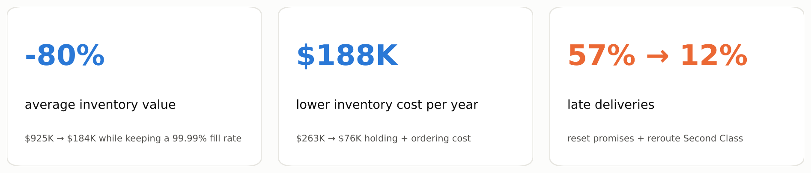
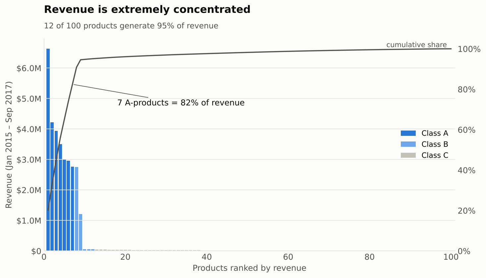
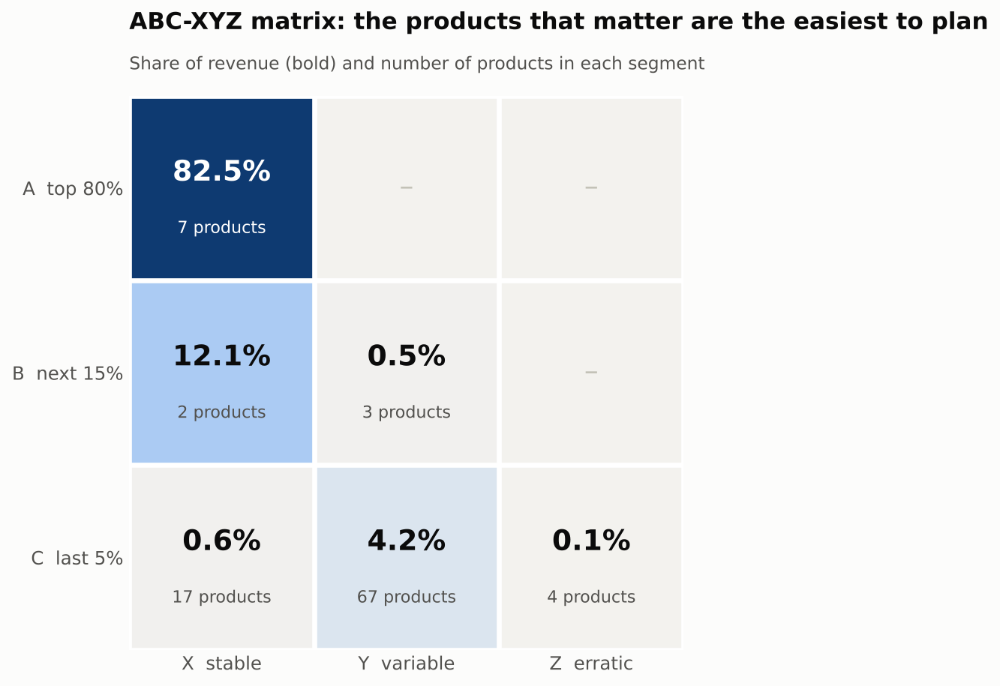
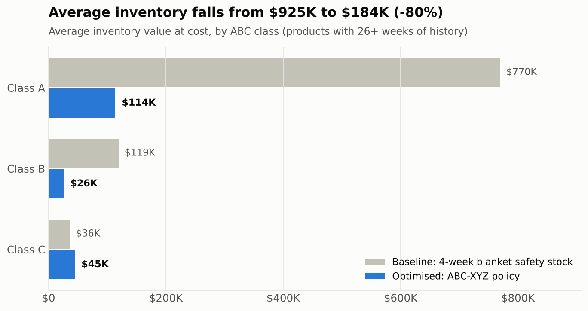
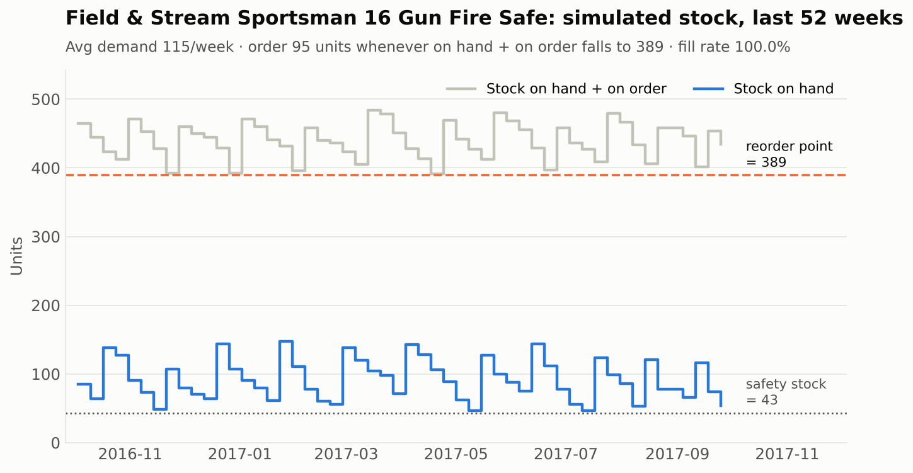
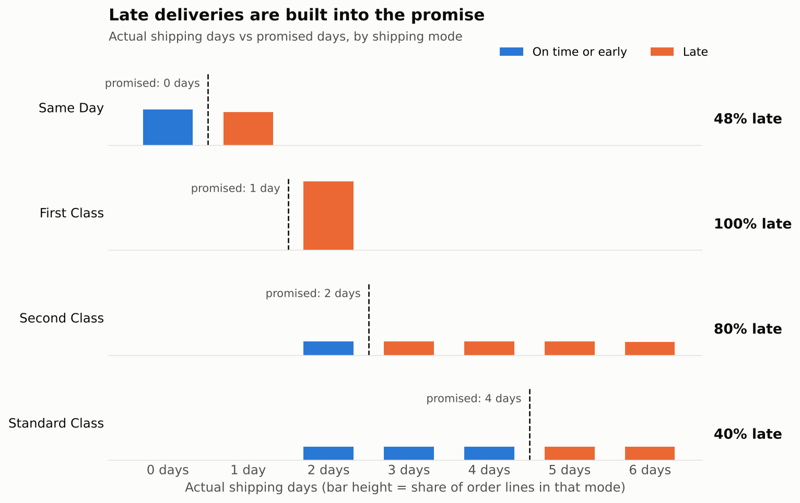
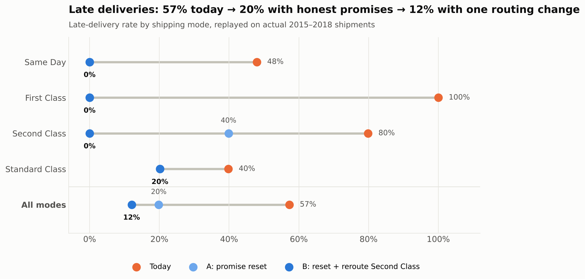
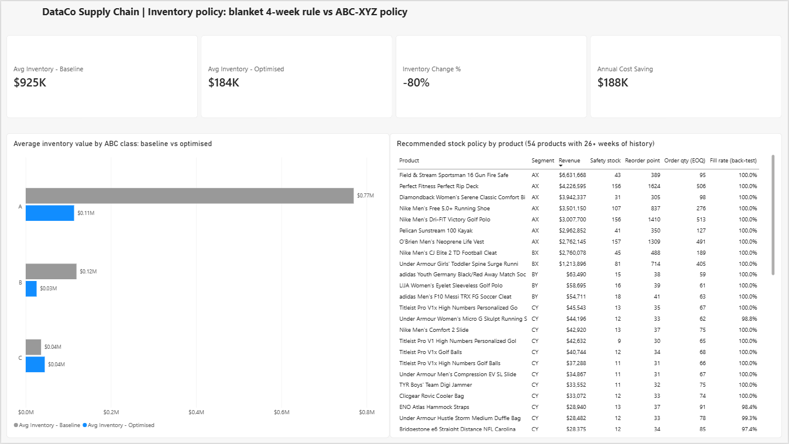
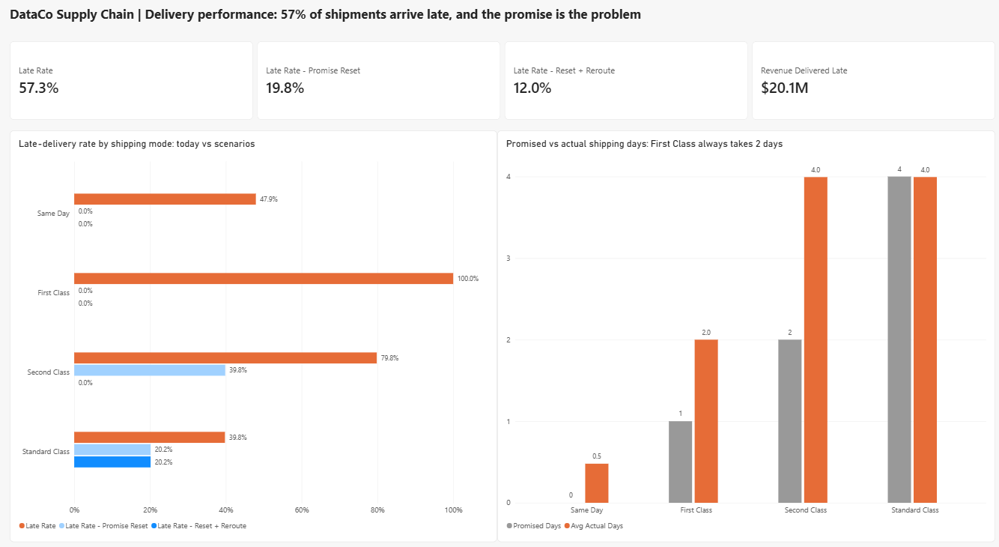

# Supply Chain Inventory Optimization & Delivery Root-Cause Analysis

**An end-to-end business analytics project on 180K real order lines: segment the product range, design a data-driven inventory policy, find out why most deliveries are late, and put a dollar value on every recommendation.**

`Python (pandas, SciPy)` · `SQL Server` · `Power BI (DAX)` · `Excel (what-if model)` · `Matplotlib`



---

## 1. Business problem

DataCo Global sells sporting goods, apparel and electronics in five markets. Two problems keep coming up in operations reviews:

- **More than half of all deliveries arrive late.**
- **Inventory is managed with a blanket rule:** 4 weeks of safety stock for every product, no matter how much it sells or how predictable it is.

**Stakeholder:** VP of Supply Chain & Operations

| # | Business question | Where it's answered |
|---|---|---|
| 1 | Which products drive revenue, and how predictable is their demand? | [`02_abc_xyz_segmentation`](python/02_abc_xyz_segmentation.ipynb) |
| 2 | What should each product's safety stock, reorder point and order quantity be, and what is it worth? | [`03_inventory_policy`](python/03_inventory_policy.ipynb) |
| 3 | Why are deliveries late, and what would fixing it change? | [`04_delivery_root_cause`](python/04_delivery_root_cause.ipynb) |

---

## 2. Key results

| Area | Today | Recommended | Impact |
|---|---|---|---|
| Average inventory value | $925K | **$184K** | **−80%**, about $741K of working capital released |
| Annual inventory cost (holding + ordering) | $263K | **$76K** | **−$188K / year** |
| Fill rate (back-tested on real demand) | ~100% | **99.99%** | Service maintained |
| Late-delivery rate | 57% | **12%** | Most late deliveries removed |
| Revenue delivered late | $6.5M / year | **$1.4M / year** | −$5.1M / year exposure |

📄 **[Executive summary (1 page)](docs/executive_summary.md)**

---

## 3. Data

- **Source:** [DataCo Smart Supply Chain dataset (Kaggle)](https://www.kaggle.com/datasets/shashwatwork/dataco-smart-supply-chain-for-big-data-analysis)
- 180,519 order lines · 65,752 orders · 20,652 customers · 118 products · Jan 2015 – Jan 2018

**Cleaning highlights** (full log: [`docs/data_quality_log.md`](docs/data_quality_log.md))
- Removed personal data, 2 empty columns and 6 duplicate column pairs (each verified as identical before dropping). 53 → 39 columns.
- **Found a catalog break in October 2017:** only 13 of 100 products continue, and volume halves. Modelling demand across that break would distort every forecast, so **demand is modelled on Jan 2015 – Sep 2017**.
- Excluded cancelled and suspected-fraud orders from demand and delivery analysis (they never ship).

---

## 4. Demand segmentation (ABC-XYZ)



**7 of 100 products generate 82% of revenue**, much steeper than the classic 80/20.



- **All A-products are X (stable):** weekly demand varies only about 10%. The products that matter most are also the easiest to plan.
- **The long tail (88 C-products, about 5% of revenue) is mostly Y (variable)** and should carry lean stock or be reviewed for delisting.

---

## 5. Inventory policy

A weekly-review **(R, s, Q)** policy per product:

| | Formula |
|---|---|
| Safety stock | z(service level) × σ(weekly demand) × √(lead time + review period) |
| Reorder point | avg weekly demand × (lead time + review period) + safety stock |
| Order quantity | EOQ = √(2 × annual demand × ordering cost ÷ holding cost per unit) |

Service level targets: **A 98% · B 95% · C 90%**. Assumptions: 2-week lead time, 25% annual holding cost, $50 per order. All of them can be changed in the [Excel what-if model](excel/inventory_policy_model.xlsx).



**Does the leaner policy still serve customers?** Each product's policy was replayed week by week against its **actual demand history**:



| Class | Target service | Back-tested fill rate |
|---|---|---|
| A | 98% | 100.0% |
| B | 95% | 100.0% |
| C | 90% | 99.8% |

The blanket rule buys essentially no extra service for about **5× the inventory**.

---

## 6. Why deliveries are late



- **First Class:** promises 1 day and takes **exactly 2 days, every time**, so it is 100% late by design.
- **Second Class:** promises 2 days, but its transit is spread evenly over 2–6 days. That is **identical to Standard Class** (chi-square p = 0.40), so premium customers get standard speed.
- **Market, region, customer segment, department and payment type barely matter.** Within Standard or Second Class, late rates differ by only about 1 point across markets.
- **Customer impact:** customers whose first order was late came back at the same rate (about 95%) as everyone else. This analysis therefore **does not claim lost revenue**. The risk is to premium-service credibility: **$4.0M a year** of First and Second Class revenue is sold on a promise that cannot be met.

**Scenarios, replayed on actual shipments:**



| Scenario | Change | Late rate |
|---|---|---|
| Today | – | 57% |
| A. Promise reset | Promise what each mode actually delivers (1 / 2 / 4 / 5 days) | 20% |
| B. A + reroute Second Class | Ship Second Class on the 2-day First Class lane, promise 3 days | **12%** |

---

## 7. Power BI dashboard

A 2-page interactive dashboard ([`powerbi/Supply_Chain_Dashboard.pbix`](powerbi/Supply_Chain_Dashboard.pbix)) built on 4 model tables with 10 DAX measures (`CALCULATE` with filter context, `DIVIDE`, scenario late rates and % change). Clicking a product in the table filters the KPI cards.

**Page 1: Inventory policy**



**Page 2: Delivery performance**



<details>
<summary>DAX measures</summary>

```DAX
Late Rate = DIVIDE(SUM(DeliveryMonthly[late_lines]), SUM(DeliveryMonthly[order_lines]))
Late Rate - Promise Reset = DIVIDE(SUM(DeliveryMonthly[late_lines_A]), SUM(DeliveryMonthly[order_lines]))
Late Rate - Reset + Reroute = DIVIDE(SUM(DeliveryMonthly[late_lines_B]), SUM(DeliveryMonthly[order_lines]))
Revenue Delivered Late = SUM(DeliveryMonthly[late_revenue])
Avg Actual Days = DIVIDE(SUM(DeliveryMonthly[actual_days_sum]), SUM(DeliveryMonthly[order_lines]))
Promised Days = MAX(DeliveryMonthly[promised_days])

Avg Inventory - Baseline = CALCULATE(SUM(InventoryComparison[avg_inventory_value]), InventoryComparison[policy] = "Baseline (4-week rule)")
Avg Inventory - Optimised = CALCULATE(SUM(InventoryComparison[avg_inventory_value]), InventoryComparison[policy] = "Optimised (ABC-XYZ)")
Inventory Change % = DIVIDE([Avg Inventory - Optimised] - [Avg Inventory - Baseline], [Avg Inventory - Baseline])
Annual Cost Saving =
    CALCULATE(SUM(InventoryComparison[annual_inventory_cost]), InventoryComparison[policy] = "Baseline (4-week rule)")
  - CALCULATE(SUM(InventoryComparison[annual_inventory_cost]), InventoryComparison[policy] = "Optimised (ABC-XYZ)")
```
</details>

---

## 8. Recommendations

1. **Adopt ABC-XYZ inventory policies.** Average inventory drops $925K → $184K and inventory cost falls by $188K a year, at a 99.99% back-tested fill rate.
2. **Reset delivery promises** to what each shipping mode actually achieves. Late deliveries fall from 57% to 20% with no operational change.
3. **Fix Second Class:** route it through the First Class lane, or merge it into Standard and stop charging a premium. Late deliveries fall to 12%.
4. **Next:** negotiate a tighter Standard Class transit window (currently 2–6 days), the only remaining source of lateness, and review the 88-product C-tail for delisting.

---

## 9. Limitations

- **No inventory, supplier or cost data** in the source. Lead time, holding cost and ordering cost are stated assumptions, and the Excel model lets you test other values.
- **The back-test is in-sample.** The policy is evaluated on the same history used to estimate it. In production, parameters would be re-estimated monthly and tracked against actual fill rate.
- **The data behaves like a simulated dataset:** transit times are perfectly uniform, demand is very flat, and lateness doesn't affect customers. The methods carry over to real data, but the size of the effects would differ.

---

## 10. Repository structure

```
├── python/
│   ├── 01_data_profiling_and_cleaning.ipynb   profiling, quality checks, clean table
│   ├── 02_abc_xyz_segmentation.ipynb          revenue & variability segmentation
│   ├── 03_inventory_policy.ipynb              safety stock, ROP, EOQ, back-test
│   ├── 04_delivery_root_cause.ipynb           late-delivery drivers & scenarios
│   ├── chart_style.py                         shared chart styling
│   └── make_readme_banner.py                  headline image for this README
├── sql/
│   ├── 01_create_and_load.sql                 SQL Server table + bulk load + validation
│   └── 02_analysis_queries.sql                ABC with window functions, delivery KPIs, scenarios
├── powerbi/
│   ├── Supply_Chain_Dashboard.pbix            2-page dashboard: inventory policy + delivery performance
│   └── powerbi_data.xlsx                      model-ready tables the dashboard loads
├── excel/inventory_policy_model.xlsx          what-if model (change assumptions, see impact)
├── results/                                   output tables (segments, policy, scenarios)
├── images/                                    charts used in this README
├── docs/
│   ├── executive_summary.md                   1-page summary for a VP audience
│   └── data_quality_log.md                    every cleaning decision with evidence
└── data/                                      raw + processed data (not committed, see below)
```

## 11. How to run

1. Download the dataset from [Kaggle](https://www.kaggle.com/datasets/shashwatwork/dataco-smart-supply-chain-for-big-data-analysis) and put `DataCoSupplyChainDataset.csv` in `data/raw/`.
2. `pip install -r requirements.txt`
3. Run the notebooks in `python/` in order (01 → 04), then `python make_readme_banner.py`.
4. *(Optional)* In SSMS, run `sql/01_create_and_load.sql`, then `sql/02_analysis_queries.sql`.
5. Open `powerbi/Supply_Chain_Dashboard.pbix` in Power BI Desktop. If prompted, point the data source to `powerbi/powerbi_data.xlsx`.

---

**Author:** Sowrav Anilkumar · M.S. Business Analytics, University of New Haven
